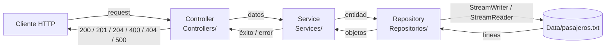
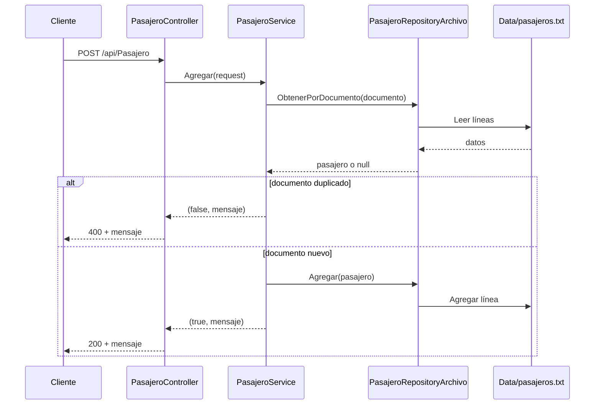
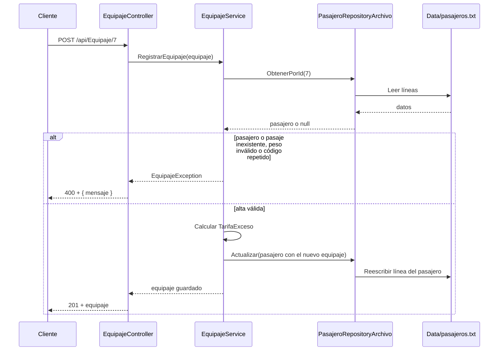

# Universidad Nacional de Misiones

## Seminario de Lenguajes II — Proyecto 1

# Sistema de Check-In de Aerolínea

### API REST con arquitectura en capas y persistencia en archivos de texto

| Dato | Completar |
| --- | --- |
| **Materia** | Seminario de Lenguajes II |
| **Proyecto** | Proyecto 1 |
| **Comisión** | _[completar]_ |
| **Grupo** | _[completar]_ |
| **Año** | 2026 |
| **Fecha de entrega** | _[completar]_ |

### Integrantes

| N.º | Nombre y apellido | Módulo |
| --- | --- | --- |
| 1 | _[completar]_ | Pasajeros (negocio y dominio) |
| 2 | _[completar]_ | Pasajes y vuelos (negocio y dominio) |
| 3 | _[completar]_ | Equipajes (negocio y dominio) |
| 4 | _[completar]_ | Persistencia en archivos TXT |
| 5 | _[completar]_ | Controladores, interfaz y unificación |

---

## Índice

1. [Introducción](#1-introducción)
2. [Arquitectura en capas](#2-arquitectura-en-capas)
3. [Módulo de Pasajeros](#3-módulo-de-pasajeros)
4. [Módulo de Pasajes](#4-módulo-de-pasajes)
5. [Módulo de Equipajes](#5-módulo-de-equipajes)
6. [Persistencia](#6-persistencia)
7. [Controladores, endpoints e integración](#7-controladores-endpoints-e-integración)
8. [Flujo completo de una operación](#8-flujo-completo-de-una-operación)
9. [Estado de implementación y pendientes](#9-estado-de-implementación-y-pendientes)
10. [Conclusiones](#10-conclusiones)

---

## 1. Introducción

El proyecto consiste en una API REST para administrar el check-in de una aerolínea. La API permite gestionar pasajeros, los pasajes asociados a cada uno y sus equipajes, con la tarifa por exceso de peso. Los datos de pasajeros, pasajes y equipajes se guardan en un archivo de texto (`Data/pasajeros.txt`), sin base de datos ni servicios externos.

La aplicación está desarrollada con **.NET 10** y **ASP.NET Core** con controladores. Se eligió una arquitectura en capas para separar las responsabilidades de presentación (HTTP), negocio y persistencia, de modo que cada integrante del grupo pueda trabajar sobre su módulo sin mezclar responsabilidades.

Alcance de esta entrega:

- CRUD completo de pasajeros, con búsqueda por ID y por documento.
- CRUD de pasajes asociados a un pasajero, con cálculo automático de precios.
- CRUD de equipajes por pasajero, con validación de integridad, límite de peso y cálculo de la tarifa por exceso, persistidos junto con su pasajero.
- Menú de descubrimiento de la API en `GET /api` y redirección de `GET /` hacia ese menú.
- Manejo uniforme de errores de formato y de excepciones no controladas.

---

## 2. Arquitectura en capas

La solución se organiza en cuatro capas y una carpeta de datos:

| Carpeta | Capa | Responsabilidad |
| --- | --- | --- |
| `Controllers/` | Presentación (HTTP) | Recibe las peticiones, enlaza el JSON a los DTO, llama al servicio y traduce el resultado a códigos HTTP y mensajes. |
| `Services/` | Negocio | Aplica las reglas del dominio: validaciones de formato, duplicados, cálculo de precios y armado de mensajes. No conoce HTTP ni detalles de archivos. |
| `Repositorios/` | Persistencia | Lee y escribe el archivo de texto. Traduce los errores de disco a excepciones propias de la aplicación. |
| `Modelos/` | Dominio | Entidades (`Pasajero`, `Pasaje`, `Equipaje`), DTO de entrada (`PasajeroRequest`, `PasajeRequest`, `EquipajeRequest`) y excepciones del dominio. |
| `Data/` | Datos | Archivo `pasajeros.txt`, con una línea por pasajero que incluye su pasaje y sus equipajes. |

Las dependencias se resuelven por inyección en `Program.cs`:

- `IPasajeroRepository` se registra como `PasajeroRepositoryArchivo`, apuntando a `Data/pasajeros.txt`.
- `PasajeroService`, `PasajeService`, `EquipajeService` y `CheckInService` se registran con alcance *scoped*.

El flujo de una petición es siempre descendente: `Controller → Service → Repository → archivo`, y la respuesta vuelve por el mismo camino. Ninguna capa superior conoce cómo se guardan los datos, y el repositorio no conoce HTTP.

La API se publica en `http://localhost:5129` con el perfil `http` de `launchSettings.json`, y en desarrollo se expone el documento OpenAPI en `/openapi/v1.json`.

---

## 3. Módulo de Pasajeros

### 3.1 Dominio

La clase `Pasajero` (`Modelos/Pasajero.cs`) representa a una persona que viaja. Mantiene sus datos en atributos privados y los expone mediante propiedades:

- `Id`, `Nombre`, `Apellido`, `Documento`, `Email`, `Telefono`, `PasajeroFrecuente`.
- `Pasaje` (opcional) y la propiedad calculada `TienePasaje`.
- La lista de equipajes, expuesta con `getEquipajes()`, administrada con `agregarEquipaje(...)` y `quitarEquipaje(...)`, y publicada en las respuestas JSON mediante la propiedad `Equipajes`.

El constructor valida la integridad mínima: `documento`, `nombre` y `apellido` no pueden estar vacíos; si lo están, lanza `DatosInvalidosException`. El email se normaliza a minúsculas y se recortan los espacios de los campos de texto.

El pasaje se administra con dos métodos que aplican reglas:

- `AsignarPasaje(Pasaje pasaje)`: rechaza `null` y verifica que el DNI del pasaje corresponda al del pasajero (comparando sin puntos ni espacios). Si el pasaje todavía no tiene dueño, adopta el DNI del pasajero.
- `QuitarPasaje()`: deja al pasajero sin pasaje.

### 3.2 Servicio

`PasajeroService` concentra las reglas de negocio:

| Regla | Detalle |
| --- | --- |
| DNI | Se normaliza quitando puntos, espacios y guiones. Debe tener 7 u 8 dígitos. |
| Email | Obligatorio, con formato `usuario@dominio.ext`. |
| Teléfono | Opcional. Si viene, admite números, espacios, guiones, paréntesis y `+`, con 6 a 15 dígitos. |
| Duplicados | No se permite dar de alta dos pasajeros con el mismo DNI. Al actualizar, el pasajero no se compara consigo mismo. |

Los métodos públicos (`Agregar`, `Actualizar`, `Eliminar`) capturan las excepciones del dominio y devuelven una tupla `(bool exito, string mensaje)`. Así el controlador no necesita conocer los tipos de excepción del negocio. Al actualizar se conservan el pasaje y los equipajes existentes.

### 3.3 Datos de entrada

El cuerpo de `POST` y `PUT` se enlaza al DTO `PasajeroRequest`, con campos opcionales a nivel de tipos:

```json
{
  "nombre": "Ada",
  "apellido": "Lovelace",
  "documento": "12345678",
  "email": "ada@correo.com",
  "telefono": "3764123456",
  "pasajeroFrecuente": "AR123"
}
```

`PasajeroFrecuente` es un texto libre y no es obligatorio. Las validaciones de formato las aplica el servicio, no el DTO.

---

## 4. Módulo de Pasajes

### 4.1 Dominio

La clase `Pasaje` (`Modelos/Pasaje.cs`) contiene:

- `IdPasaje`, `DniPasajero`, `Asiento`, `FechaEmision`.
- `TipoVuelo`: `N` (nacional) o `I` (internacional).
- `TipoTarifa`: `P` (primera/premium), `B` (business), `PE` (premium economy) o `F` (economy).
- `NroVuelo`, `PrecioBase`, `PrecioFinal`.

El constructor valida que el DNI, el número de vuelo y el asiento no estén vacíos, y que `tipoVuelo` y `tipoTarifa` pertenezcan a los valores admitidos. Las tarifas y los tipos de vuelo se normalizan a mayúsculas.

Los precios se calculan en el dominio:

| Concepto | Importe |
| --- | ---: |
| Precio base nacional (`N`) | $200.000 |
| Precio base internacional (`I`) | $500.000 |
| Adicional Economy (`F`) | $250.000 |
| Adicional Premium Economy (`PE`) | $300.000 |
| Adicional Business (`B`) | $350.000 |
| Adicional Primera/Premium (`P`) | $400.000 |

`PrecioFinal` es la suma del precio base del vuelo más el adicional de la tarifa. El cliente no envía importes: el servidor los determina a partir de `tipoVuelo` y `tipoTarifa`.

### 4.2 Servicio

`PasajeService` administra los pasajes dentro de su pasajero:

- `ListarPasajes()`: devuelve solo los pasajes asignados.
- `ObtenerPasaje(idPasajero)`: devuelve el pasaje del pasajero o `null`.
- `AgregarPasaje(idPasajero, request)`: verifica que el pasajero exista, busca el primer asiento libre del vuelo y crea el pasaje con ese asiento. El avión se modela con filas `1` a `30` y columnas `A` a `F`; dos pasajes del mismo `nroVuelo` no repiten asiento.
- `ActualizarPasaje(idPasajero, request)`: recalcula los precios y conserva la fecha de emisión y el asiento.
- `EliminarPasaje(idPasajero)`: quita el pasaje del pasajero y conserva al pasajero.

Los métodos devuelven tuplas con un indicador `noEncontrado` para que el controlador pueda distinguir entre `404` y `400`.

También está registrado `CheckInService`, que replica parte de la lógica de pasajes pero no está expuesto por ningún controlador en la versión actual. El controlador de pasajes usa `PasajeService`.

### 4.3 Datos de entrada

El cuerpo de `POST` y `PUT` se enlaza a `PasajeRequest`:

```json
{
  "tipoVuelo": "N",
  "tipoTarifa": "P",
  "nroVuelo": "AR1234"
}
```

El pasaje se identifica siempre por el **ID del pasajero** en la ruta: `/api/Pasajes/{idPasajero}`.

---

## 5. Módulo de Equipajes

### 5.1 Dominio

La clase `Equipaje` (`Modelos/Equipaje.cs`) representa una valija o bulto asociado a un pasajero:

- `CodigoEtiqueta`: identifica la etiqueta del equipaje.
- `PasajeroId`: pasajero al que pertenece.
- `PesoKg`: peso declarado.
- `TipoEquipaje`: texto libre (por ejemplo, `Mano` o `Bodega`).
- `TarifaExceso`: importe calculado por el servidor; el cliente no lo envía.

`EquipajeException` (`Modelos/Exceptions/EquipajeException.cs`) es la excepción del módulo. El servicio la usa tanto para los errores de integridad como para los de peso.

### 5.2 Servicio

`EquipajeService` (`Services/EquipajeService.cs`) implementa las reglas del proyecto de origen:

| Regla | Detalle |
| --- | --- |
| Integridad | El pasajero debe existir (`Error de integridad: El pasajero con ID '...' no existe en el sistema.`) y tener un pasaje asignado (`... no tiene un pasaje asignado.`). En ambos casos lanza `EquipajeException` y el manejador central responde `400`. |
| Peso mínimo | `PesoKg` debe ser mayor que `0`; si no, lanza `EquipajeException` con `El peso del equipaje debe ser mayor a 0 kg.` |
| Límite nacional | `15 kg` para vuelos nacionales (`N`). |
| Límite internacional | `23 kg` para vuelos internacionales (`I`). |
| Tarifa por exceso | `$2.500` por cada kilogramo que supere el límite. Si no hay exceso, la tarifa es `0`. |

Además de calcular, el servicio administra el ciclo de vida de los equipajes:

| Operación | Detalle |
| --- | --- |
| `ListarEquipajes()` | Recorre todos los pasajeros y devuelve sus equipajes. |
| `ListarPorPasajero(idPasajero)` | Devuelve los equipajes del pasajero, o `null` si el pasajero no existe. |
| `ObtenerPorCodigo(idPasajero, codigo)` | Busca un equipaje por su código de etiqueta, sin distinguir mayúsculas. |
| `RegistrarEquipaje(equipaje)` | Valida integridad, peso y código; calcula la tarifa y guarda el pasajero actualizado. |
| `ActualizarEquipaje(...)` | Cambia peso y tipo, recalcula la tarifa y guarda. El código de etiqueta no se modifica. |
| `EliminarEquipaje(...)` | Quita el equipaje de la lista del pasajero y guarda. |

El código de etiqueta es la identidad del equipaje dentro de su pasajero: se exige en el alta, no se puede repetir para el mismo pasajero y no cambia en la actualización. Las operaciones de actualización y baja devuelven una tupla `(bool exito, string mensaje, bool noEncontrado)` para que el controlador distinga entre `400` y `404`. El servicio se registra en el contenedor de dependencias de `Program.cs` con alcance *scoped*.

### 5.3 Datos de entrada

El cuerpo de `POST` y `PUT` se enlaza a `EquipajeRequest`:

```json
{
  "codigoEtiqueta": "EQ-001",
  "tipoEquipaje": "Bodega",
  "pesoKg": 20
}
```

El pasajero se identifica por la ruta (`/api/Equipaje/{idPasajero}`), igual que en Pasajes. En `PUT` y `DELETE` la ruta incluye además el código de etiqueta (`/api/Equipaje/{idPasajero}/{codigoEtiqueta}`). El servidor calcula `tarifaExceso`; por eso el campo no forma parte del DTO. El identificador del pasajero tampoco se envía en el cuerpo: lo aporta la ruta.

Ejemplo: un equipaje de `20 kg` en un vuelo nacional (`15 kg` permitidos) genera un exceso de `5 kg` y una tarifa de `$12.500`. El mismo equipaje en un vuelo internacional no genera exceso, porque el límite es `23 kg`.

### 5.4 Persistencia

Los equipajes se guardan en la misma línea del pasajero dentro de `Data/pasajeros.txt`, en el campo opcional 15 (ver §6.1). No hay un archivo aparte ni un repositorio adicional: `EquipajeService` pide el pasajero a `IPasajeroRepository`, modifica su lista de equipajes y llama a `Actualizar(...)`, que reescribe el archivo.

Esta decisión tiene tres consecuencias:

- **Cascada automática:** al eliminar un pasajero desaparecen sus equipajes, porque estaban dentro de su línea.
- **Compatibilidad:** el campo 15 es opcional, así que las líneas anteriores sin equipajes se siguen leyendo sin cambios.
- **Consistencia:** al actualizar los datos personales de un pasajero, `PasajeroService.Actualizar` copia los equipajes existentes al objeto nuevo, de modo que una edición no los borra.

---

## 6. Persistencia

La persistencia está implementada en `Repositorios/PasajeroRepositoryArchivo.cs` sobre un archivo de texto plano: `Data/pasajeros.txt`.

### 6.1 Formato

Cada pasajero ocupa una línea con campos separados por `|`:

```text
Id | Nombre | Apellido | Documento | PasajeroFrecuente | Email | Teléfono
   | IdPasaje | TipoVuelo | TipoTarifa | NroVuelo
   | PrecioBase | PrecioFinal | FechaEmision | Asiento
   | Equipajes (opcional)
```

Si el pasajero no tiene pasaje, los ocho campos del pasaje quedan vacíos. El DNI del pasaje no se guarda porque es el mismo del pasajero. Los decimales y las fechas se escriben con `CultureInfo.InvariantCulture` y formato ISO 8601, para que el archivo se lea igual en cualquier máquina.

El campo 15 es opcional y solo se escribe si el pasajero tiene equipajes. Cada equipaje ocupa un bloque con cuatro datos separados por comas, y los bloques se separan con `;`:

```text
codigo,tipo,peso,tarifa;codigo,tipo,peso,tarifa
```

El código de etiqueta y el tipo de equipaje se escapan con `Uri.EscapeDataString` antes de guardarse y se recuperan con `Uri.UnescapeDataString`, para que una coma o un punto y coma dentro de un texto no rompa el formato. El peso y la tarifa se escriben con `CultureInfo.InvariantCulture`. Por ejemplo, un pasajero con dos equipajes podría terminar la línea así:

```text
...|AR1234|200000|600000|2026-11-17T10:30:00.0000000-03:00|14A|EQ-001,Bodega,20,12500;EQ-002,Mano,10,0
```

`Pasajero.ToString()` genera la línea y `Pasajero.FromString(linea)` la reconstruye, incluidos los equipajes. Si una línea está dañada, no se ignora en silencio: se lanza `ArchivoException` con el número de línea, para evitar que una operación posterior reescriba el archivo sin esos registros.

### 6.2 Operaciones

| Operación | Implementación |
| --- | --- |
| Listar | Lee el archivo completo y devuelve la lista. |
| Buscar por ID | Lee el archivo y filtra en memoria. |
| Buscar por documento | Lee el archivo y filtra en memoria. |
| Alta | Asigna el ID siguiente (`máximo + 1`) y agrega una línea al final. |
| Actualización | Reemplaza el registro en memoria y reescribe el archivo completo. |
| Baja | Quita el registro y reescribe el archivo completo. |

### 6.3 Escritura segura y errores

- Todas las operaciones públicas se serializan con un `lock`, para que un solo pedido toque el archivo a la vez.
- La reescritura se hace sobre un archivo temporal (`pasajeros.txt.tmp`) y luego se reemplaza el original con `File.Move(..., overwrite: true)`. Si falla la escritura, el archivo original no queda vacío.
- Los errores de disco (`FileNotFoundException`, `DirectoryNotFoundException`, `UnauthorizedAccessException`, `IOException`) se traducen a `ArchivoException`, la excepción propia de la capa de persistencia.

Como los equipajes viven en la línea del pasajero, cualquier operación sobre ellos reutiliza la reescritura segura descripta arriba: no hay un camino de escritura alternativo.

---

## 7. Controladores, endpoints e integración

### 7.1 Menú principal

`GET /api` devuelve un JSON con los módulos disponibles y sus rutas:

```json
{
  "api": "CheckInApi",
  "descripcion": "API de check-in de una aerolínea",
  "modulos": [
    { "entidad": "Pasajeros", "ruta": "/api/Pasajero", "operaciones": ["..."] },
    { "entidad": "Pasajes", "ruta": "/api/Pasajes", "operaciones": ["..."] },
    { "entidad": "Equipajes", "ruta": "/api/Equipaje", "operaciones": ["..."] }
  ]
}
```

`GET /` redirige a `/api`.

### 7.2 Endpoints de Pasajeros

| Método | Ruta | Respuesta |
| --- | --- | --- |
| `GET` | `/api/Pasajero` | `200` con la lista. |
| `GET` | `/api/Pasajero/{id}` | `200` o `404`. |
| `GET` | `/api/Pasajero/documento/{documento}` | `200` o `404`. |
| `POST` | `/api/Pasajero` | `200` con mensaje, o `400` si es inválido o duplicado. |
| `PUT` | `/api/Pasajero/{id}` | `200`, `404` si no existe, `400` si es inválido. |
| `DELETE` | `/api/Pasajero/{id}` | `200`, o `404` si no existe. |

Las respuestas de los `GET` de Pasajeros incluyen el pasaje (`pasaje`) y los equipajes (`equipajes`) del pasajero. Los equipajes también se pueden consultar por separado en `/api/Equipaje/{idPasajero}`.

### 7.3 Endpoints de Pasajes

| Método | Ruta | Respuesta |
| --- | --- | --- |
| `GET` | `/api/Pasajes` | `200` con la lista de pasajes. |
| `GET` | `/api/Pasajes/{idPasajero}` | `200` con el pasaje, o `404`. |
| `POST` | `/api/Pasajes/{idPasajero}` | `201`, `404` si el pasajero no existe, `400` si los datos son inválidos. |
| `PUT` | `/api/Pasajes/{idPasajero}` | `200` con mensaje, `404` si el pasajero no existe, `400` si los datos son inválidos. |
| `DELETE` | `/api/Pasajes/{idPasajero}` | `200` con `{ "mensaje": ... }`, `404` si el pasajero no existe o no tiene pasaje, `400` si falla la escritura. |

### 7.4 Endpoints de Equipajes

| Método | Ruta | Respuesta |
| --- | --- | --- |
| `GET` | `/api/Equipaje` | `200` con todos los equipajes registrados. |
| `GET` | `/api/Equipaje/{idPasajero}` | `200` con la lista del pasajero, o `404` si el pasajero no existe. |
| `GET` | `/api/Equipaje/{idPasajero}/{codigoEtiqueta}` | `200` con el equipaje, o `404`. |
| `POST` | `/api/Equipaje/{idPasajero}` | `201` con el equipaje y la `tarifaExceso` calculada, o `400` si el pasajero no existe, no tiene pasaje, el peso es inválido o el código está vacío o repetido. |
| `PUT` | `/api/Equipaje/{idPasajero}/{codigoEtiqueta}` | `200` con mensaje, `404` si el pasajero o el equipaje no existen, `400` si el peso es inválido. |
| `DELETE` | `/api/Equipaje/{idPasajero}/{codigoEtiqueta}` | `200` con mensaje, o `404` si el pasajero o el equipaje no existen. |

### 7.5 Mapeo de entradas y mensajes

El controlador es la única capa que conoce HTTP:

1. Recibe el cuerpo JSON y lo enlaza a `PasajeroRequest`, `PasajeRequest` o `EquipajeRequest`.
2. Llama al servicio correspondiente.
3. Traduce el resultado:
   - objeto encontrado → `200 OK`;
   - `null` → `404 Not Found` con el mensaje;
   - `(false, mensaje)` → `400 Bad Request` con el mensaje;
   - `(true, mensaje)` → `200 OK` con el mensaje.

En Equipajes, la ruta aporta el ID del pasajero y, en `PUT` y `DELETE`, también el código de etiqueta. El cuerpo aporta los datos del equipaje. El controlador arma el objeto `Equipaje`, llama al servicio y responde `201` con la tarifa ya calculada al crear, `200` con `{ "mensaje": ... }` al actualizar o eliminar, y `404` cuando el pasajero o el equipaje no existen.

Los errores de negocio de Pasajeros se devuelven como texto plano. Los de Pasajes usan `{ "mensaje": ... }` porque ese controlador ya expone ese contrato. Los de Equipajes también usan `{ "mensaje": ... }`: el servicio lanza `EquipajeException` y la traduce el manejador central. Los errores de formato del JSON y las excepciones no controladas usan siempre `{ "mensaje": ... }`.

### 7.6 Control central de excepciones

`Program.cs` configura un manejador que traduce las excepciones de las capas inferiores:

| Excepción | HTTP | Mensaje |
| --- | --- | --- |
| `DatosException` / `DatosInvalidosException` | `400` | Detalle del campo inválido. |
| `EquipajeException` | `400` | Error de integridad o de peso (pasajero sin pasaje, peso no positivo). |
| `ArchivoException` | `500` | Mensaje de persistencia (archivo faltante, línea dañada, permisos). |
| `UnauthorizedAccessException` | `500` | Sin permisos sobre el archivo. |
| `IOException` | `500` | Error de lectura o escritura. |
| Otra | `500` | Error inesperado. |

La respuesta tiene la forma `{ "mensaje": "..." }`. Esto evita repetir `try/catch` en cada controlador y mantiene un único formato de error.

---

## 8. Flujo completo de una operación

**Esquema general:**



**Ejemplo con alta de pasajero:**



**Ejemplo con registro de equipaje:**



**Guion para la exposición:**

1. Abrir `GET /api` y mostrar el menú de módulos, incluido Equipajes con sus seis rutas.
2. Crear un pasajero y mostrar el mensaje de éxito.
3. Repetir el alta con el mismo documento y mostrar el `400` con el mensaje de duplicado.
4. Consultar el pasajero por documento y guardar su `id`.
5. Asignar un pasaje nacional al pasajero y consultarlo.
6. Registrar un equipaje de `20 kg` con el código `EQ-001` y mostrar el `201` con `tarifaExceso` de `$12.500`.
7. Registrar un equipaje de `10 kg` con el código `EQ-002` y mostrar que la tarifa es `0`.
8. Listar con `GET /api/Equipaje/{id}` y consultar `GET /api/Equipaje/{id}/EQ-001`.
9. Enviar `pesoKg: 0` y mostrar el `400` con el mensaje de peso inválido; repetir el código `EQ-001` y mostrar el `400` de duplicado.
10. Actualizar `EQ-001` a `30 kg` con `PUT` y mostrar el recálculo de la tarifa.
11. Actualizar los datos personales del pasajero con `PUT /api/Pasajero/{id}` y volver a listar sus equipajes para mostrar que siguen ahí.
12. Reiniciar la API, consultar de nuevo y mostrar que los equipajes se conservaron en el archivo.
13. Eliminar `EQ-002` con `DELETE` y mostrar que ya no aparece.
14. Enviar un tipo de vuelo inválido y mostrar el error de negocio.
15. Eliminar el pasajero y mostrar el `404` al volver a consultarlo o al pedir sus equipajes.

---

## 9. Estado de implementación y pendientes

| Módulo | Estado | Pendiente |
| --- | --- | --- |
| Pasajeros | CRUD completo y búsqueda por documento | — |
| Pasajes | CRUD completo con precios, asiento y fecha de emisión | Reasignación de asiento al cambiar de vuelo, si se exige. |
| Equipajes | CRUD completo por pasajero, con validación de integridad, límite de peso, tarifa por exceso y persistencia | — |
| Persistencia | Alta, lectura, modificación y baja de pasajeros, pasajes y equipajes con escritura segura | — |
| Control e integración | Menú con Pasajeros, Pasajes y Equipajes; endpoints, mapeo, mensajes y manejo central de errores | — |

## 10. Conclusiones

La separación en capas permitió que cada integrante trabajara sobre su módulo sin mezclar responsabilidades: el controlador no sabe cómo se guarda un pasajero, el servicio no sabe cómo se escribe un archivo y el repositorio no conoce HTTP. El resultado es una API funcional para pasajeros, pasajes y equipajes, con cálculo automático de precios y tarifas, mensajes de éxito y error uniformes, un menú de descubrimiento y persistencia completa en un único archivo de texto.

Guardar los equipajes dentro de la línea de su pasajero simplificó la integridad: no hizo falta un repositorio nuevo ni una clave foránea manual, la baja del pasajero arrastra sus equipajes y el formato anterior sigue siendo válido gracias al campo opcional. La principal enseñanza fue que un formato de texto simple exige cuidar el escapado y la compatibilidad hacia atrás.
