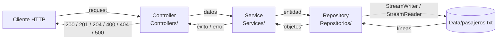
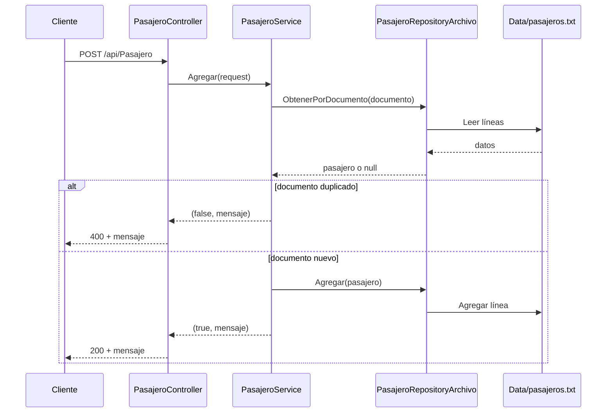

# Universidad Nacional de Misiones

## Seminario de Lenguajes II — Proyecto 1

# Sistema de Check-In de Aerolínea

### API REST con arquitectura en capas y persistencia en archivos de texto

| Dato | Completar |
| --- | --- |
| **Materia** | Seminario de Lenguajes II |
| **Proyecto** | Proyecto 1 |
| **Comisión** | _[completar]_ |
| **Grupo** | _[completar]_ |
| **Año** | 2026 |
| **Fecha de entrega** | _[completar]_ |

### Integrantes

| N.º | Nombre y apellido | Módulo |
| --- | --- | --- |
| 1 | _[completar]_ | Pasajeros (negocio y dominio) |
| 2 | _[completar]_ | Pasajes y vuelos (negocio y dominio) |
| 3 | _[completar]_ | Equipajes (negocio y dominio) |
| 4 | _[completar]_ | Persistencia en archivos TXT |
| 5 | _[completar]_ | Controladores, interfaz y unificación |

---

## Índice

1. [Introducción](#1-introducción)
2. [Arquitectura en capas](#2-arquitectura-en-capas)
3. [Módulo de Pasajeros](#3-módulo-de-pasajeros)
4. [Módulo de Pasajes](#4-módulo-de-pasajes)
5. [Módulo de Equipajes](#5-módulo-de-equipajes)
6. [Persistencia](#6-persistencia)
7. [Controladores, endpoints e integración](#7-controladores-endpoints-e-integración)
8. [Flujo completo de una operación](#8-flujo-completo-de-una-operación)
9. [Estado de implementación y pendientes](#9-estado-de-implementación-y-pendientes)
10. [Conclusiones](#10-conclusiones)

---

## 1. Introducción

El proyecto consiste en una API REST para administrar el check-in de una aerolínea. La API permite gestionar pasajeros y los pasajes asociados a cada uno. Los datos se guardan en un archivo de texto (`Data/pasajeros.txt`), sin base de datos ni servicios externos.

La aplicación está desarrollada con **.NET 10** y **ASP.NET Core** con controladores. Se eligió una arquitectura en capas para separar las responsabilidades de presentación (HTTP), negocio y persistencia, de modo que cada integrante del grupo pueda trabajar sobre su módulo sin mezclar responsabilidades.

Alcance de esta entrega:

- CRUD completo de pasajeros, con búsqueda por ID y por documento.
- CRUD de pasajes asociados a un pasajero, con cálculo automático de precios.
- Menú de descubrimiento de la API en `GET /api` y redirección de `GET /` hacia ese menú.
- Manejo uniforme de errores de formato y de excepciones no controladas.

El módulo de equipajes cuenta únicamente con las clases de dominio y sus excepciones; su servicio, endpoints y persistencia quedan pendientes (ver §9).

---

## 2. Arquitectura en capas

La solución se organiza en cuatro capas y una carpeta de datos:

| Carpeta | Capa | Responsabilidad |
| --- | --- | --- |
| `Controllers/` | Presentación (HTTP) | Recibe las peticiones, enlaza el JSON a los DTO, llama al servicio y traduce el resultado a códigos HTTP y mensajes. |
| `Services/` | Negocio | Aplica las reglas del dominio: validaciones de formato, duplicados, cálculo de precios y armado de mensajes. No conoce HTTP ni detalles de archivos. |
| `Repositorios/` | Persistencia | Lee y escribe el archivo de texto. Traduce los errores de disco a excepciones propias de la aplicación. |
| `Modelos/` | Dominio | Entidades (`Pasajero`, `Pasaje`, `Equipaje`), DTO de entrada (`PasajeroRequest`, `PasajeRequest`) y excepciones del dominio. |
| `Data/` | Datos | Archivo `pasajeros.txt`, con una línea por pasajero. |

Las dependencias se resuelven por inyección en `Program.cs`:

- `IPasajeroRepository` se registra como `PasajeroRepositoryArchivo`, apuntando a `Data/pasajeros.txt`.
- `PasajeroService`, `PasajeService` y `CheckInService` se registran con alcance *scoped*.

El flujo de una petición es siempre descendente: `Controller → Service → Repository → archivo`, y la respuesta vuelve por el mismo camino. Ninguna capa superior conoce cómo se guardan los datos, y el repositorio no conoce HTTP.

La API se publica en `http://localhost:5129` con el perfil `http` de `launchSettings.json`, y en desarrollo se expone el documento OpenAPI en `/openapi/v1.json`.

---

## 3. Módulo de Pasajeros

### 3.1 Dominio

La clase `Pasajero` (`Modelos/Pasajero.cs`) representa a una persona que viaja. Mantiene sus datos en atributos privados y los expone mediante propiedades:

- `Id`, `Nombre`, `Apellido`, `Documento`, `Email`, `Telefono`, `PasajeroFrecuente`.
- `Pasaje` (opcional) y la propiedad calculada `TienePasaje`.

El constructor valida la integridad mínima: `documento`, `nombre` y `apellido` no pueden estar vacíos; si lo están, lanza `DatosInvalidosException`. El email se normaliza a minúsculas y se recortan los espacios de los campos de texto.

El pasaje se administra con dos métodos que aplican reglas:

- `AsignarPasaje(Pasaje pasaje)`: rechaza `null` y verifica que el DNI del pasaje corresponda al del pasajero (comparando sin puntos ni espacios). Si el pasaje todavía no tiene dueño, adopta el DNI del pasajero.
- `QuitarPasaje()`: deja al pasajero sin pasaje.

### 3.2 Servicio

`PasajeroService` concentra las reglas de negocio:

| Regla | Detalle |
| --- | --- |
| DNI | Se normaliza quitando puntos, espacios y guiones. Debe tener 7 u 8 dígitos. |
| Email | Obligatorio, con formato `usuario@dominio.ext`. |
| Teléfono | Opcional. Si viene, admite números, espacios, guiones, paréntesis y `+`, con 6 a 15 dígitos. |
| Duplicados | No se permite dar de alta dos pasajeros con el mismo DNI. Al actualizar, el pasajero no se compara consigo mismo. |

Los métodos públicos (`Agregar`, `Actualizar`, `Eliminar`) capturan las excepciones del dominio y devuelven una tupla `(bool exito, string mensaje)`. Así el controlador no necesita conocer los tipos de excepción del negocio. Al actualizar se conserva el pasaje existente.

### 3.3 Datos de entrada

El cuerpo de `POST` y `PUT` se enlaza al DTO `PasajeroRequest`, con campos opcionales a nivel de tipos:

```json
{
  "nombre": "Ada",
  "apellido": "Lovelace",
  "documento": "12345678",
  "email": "ada@correo.com",
  "telefono": "3764123456",
  "pasajeroFrecuente": "AR123"
}
```

`PasajeroFrecuente` es un texto libre y no es obligatorio. Las validaciones de formato las aplica el servicio, no el DTO.

---

## 4. Módulo de Pasajes

### 4.1 Dominio

La clase `Pasaje` (`Modelos/Pasaje.cs`) contiene:

- `IdPasaje`, `DniPasajero`, `Asiento`, `FechaEmision`.
- `TipoVuelo`: `N` (nacional) o `I` (internacional).
- `TipoTarifa`: `P` (primera/premium), `B` (business), `PE` (premium economy) o `F` (economy).
- `NroVuelo`, `PrecioBase`, `PrecioFinal`.

El constructor valida que el DNI, el número de vuelo y el asiento no estén vacíos, y que `tipoVuelo` y `tipoTarifa` pertenezcan a los valores admitidos. Las tarifas y los tipos de vuelo se normalizan a mayúsculas.

Los precios se calculan en el dominio:

| Concepto | Importe |
| --- | ---: |
| Precio base nacional (`N`) | $200.000 |
| Precio base internacional (`I`) | $500.000 |
| Adicional Economy (`F`) | $250.000 |
| Adicional Premium Economy (`PE`) | $300.000 |
| Adicional Business (`B`) | $350.000 |
| Adicional Primera/Premium (`P`) | $400.000 |

`PrecioFinal` es la suma del precio base del vuelo más el adicional de la tarifa. El cliente no envía importes: el servidor los determina a partir de `tipoVuelo` y `tipoTarifa`.

### 4.2 Servicio

`PasajeService` administra los pasajes dentro de su pasajero:

- `ListarPasajes()`: devuelve solo los pasajes asignados.
- `ObtenerPasaje(idPasajero)`: devuelve el pasaje del pasajero o `null`.
- `AgregarPasaje(idPasajero, request)`: verifica que el pasajero exista, crea el pasaje y lo asigna.
- `ActualizarPasaje(idPasajero, request)`: recalcula los precios y conserva la fecha de emisión y el asiento.
- `EliminarPasaje(idPasajero)`: quita el pasaje del pasajero y conserva al pasajero.

Los métodos devuelven tuplas con un indicador `noEncontrado` para que el controlador pueda distinguir entre `404` y `400`.

También está registrado `CheckInService`, que replica parte de la lógica de pasajes pero no está expuesto por ningún controlador en la versión actual. El controlador de pasajes usa `PasajeService`.

### 4.3 Datos de entrada

El cuerpo de `POST` y `PUT` se enlaza a `PasajeRequest`:

```json
{
  "tipoVuelo": "N",
  "tipoTarifa": "P",
  "nroVuelo": "AR1234"
}
```

El pasaje se identifica siempre por el **ID del pasajero** en la ruta: `/api/Pasajes/{idPasajero}`.

---

## 5. Módulo de Equipajes

Este módulo se encuentra en estado de boceto. Lo que existe en el repositorio es:

- `Modelos/Equipaje.cs`: clase `Equipaje` con `PesoKg` (solo lectura) e identificador, construida a partir del peso y el id.
- `Modelos/Exceptions/EquipajeException.cs`: excepción base del módulo y `PesoExcedidoException`, que informa peso actual, peso máximo y número de ítem.
- `Pasajero` ya contiene una lista interna de equipajes con `getEquipajes()` y `agregarEquipaje(...)`.

No existen todavía servicio, controlador, registro en el contenedor de dependencias ni persistencia de equipajes en el archivo. Por ese motivo la API no expone endpoints de equipajes y el menú de `GET /api` no los lista. La rama `Equipaje` del repositorio remoto es un boceto y no se integró en esta entrega.

---

## 6. Persistencia

La persistencia está implementada en `Repositorios/PasajeroRepositoryArchivo.cs` sobre un archivo de texto plano: `Data/pasajeros.txt`.

### 6.1 Formato

Cada pasajero ocupa una línea con campos separados por `|`:

```text
Id | Nombre | Apellido | Documento | PasajeroFrecuente | Email | Teléfono
   | IdPasaje | TipoVuelo | TipoTarifa | NroVuelo
   | PrecioBase | PrecioFinal | FechaEmision | Asiento
```

Si el pasajero no tiene pasaje, los últimos ocho campos quedan vacíos. El DNI del pasaje no se guarda porque es el mismo del pasajero. Los decimales y las fechas se escriben con `CultureInfo.InvariantCulture` y formato ISO 8601, para que el archivo se lea igual en cualquier máquina.

`Pasajero.ToString()` genera la línea y `Pasajero.FromString(linea)` la reconstruye. Si una línea está dañada, no se ignora en silencio: se lanza `ArchivoException` con el número de línea, para evitar que una operación posterior reescriba el archivo sin esos registros.

### 6.2 Operaciones

| Operación | Implementación |
| --- | --- |
| Listar | Lee el archivo completo y devuelve la lista. |
| Buscar por ID | Lee el archivo y filtra en memoria. |
| Buscar por documento | Lee el archivo y filtra en memoria. |
| Alta | Asigna el ID siguiente (`máximo + 1`) y agrega una línea al final. |
| Actualización | Reemplaza el registro en memoria y reescribe el archivo completo. |
| Baja | Quita el registro y reescribe el archivo completo. |

### 6.3 Escritura segura y errores

- Todas las operaciones públicas se serializan con un `lock`, para que un solo pedido toque el archivo a la vez.
- La reescritura se hace sobre un archivo temporal (`pasajeros.txt.tmp`) y luego se reemplaza el original con `File.Move(..., overwrite: true)`. Si falla la escritura, el archivo original no queda vacío.
- Los errores de disco (`FileNotFoundException`, `DirectoryNotFoundException`, `UnauthorizedAccessException`, `IOException`) se traducen a `ArchivoException`, la excepción propia de la capa de persistencia.

Los equipajes no se persisten todavía: el archivo guarda solamente los datos del pasajero y su pasaje.

---

## 7. Controladores, endpoints e integración

### 7.1 Menú principal

`GET /api` devuelve un JSON con los módulos disponibles y sus rutas:

```json
{
  "api": "CheckInApi",
  "descripcion": "API de check-in de una aerolínea",
  "modulos": [
    { "entidad": "Pasajeros", "ruta": "/api/Pasajero", "operaciones": ["..."] },
    { "entidad": "Pasajes", "ruta": "/api/Pasajes", "operaciones": ["..."] }
  ]
}
```

`GET /` redirige a `/api`.

### 7.2 Endpoints de Pasajeros

| Método | Ruta | Respuesta |
| --- | --- | --- |
| `GET` | `/api/Pasajero` | `200` con la lista. |
| `GET` | `/api/Pasajero/{id}` | `200` o `404`. |
| `GET` | `/api/Pasajero/documento/{documento}` | `200` o `404`. |
| `POST` | `/api/Pasajero` | `200` con mensaje, o `400` si es inválido o duplicado. |
| `PUT` | `/api/Pasajero/{id}` | `200`, `404` si no existe, `400` si es inválido. |
| `DELETE` | `/api/Pasajero/{id}` | `200`, o `404` si no existe. |

### 7.3 Endpoints de Pasajes

| Método | Ruta | Respuesta |
| --- | --- | --- |
| `GET` | `/api/Pasajes` | `200` con la lista de pasajes. |
| `GET` | `/api/Pasajes/{idPasajero}` | `200` con el pasaje, o `404`. |
| `POST` | `/api/Pasajes/{idPasajero}` | `201`, `404` si el pasajero no existe, `400` si los datos son inválidos. |
| `PUT` | `/api/Pasajes/{idPasajero}` | `200` con mensaje, `404` si el pasajero no existe, `400` si los datos son inválidos. |
| `DELETE` | `/api/Pasajes/{idPasajero}` | `204`, o `404` si el pasajero no existe. |

### 7.4 Mapeo de entradas y mensajes

El controlador es la única capa que conoce HTTP:

1. Recibe el cuerpo JSON y lo enlaza a `PasajeroRequest` o `PasajeRequest`.
2. Llama al servicio correspondiente.
3. Traduce el resultado:
   - objeto encontrado → `200 OK`;
   - `null` → `404 Not Found` con el mensaje;
   - `(false, mensaje)` → `400 Bad Request` con el mensaje;
   - `(true, mensaje)` → `200 OK` con el mensaje.

Los errores de negocio de Pasajeros se devuelven como texto plano. Los de Pasajes usan `{ "mensaje": ... }` porque ese controlador ya expone ese contrato. Los errores de formato del JSON y las excepciones no controladas usan siempre `{ "mensaje": ... }`.

### 7.5 Control central de excepciones

`Program.cs` configura un manejador que traduce las excepciones de las capas inferiores:

| Excepción | HTTP | Mensaje |
| --- | --- | --- |
| `DatosException` / `DatosInvalidosException` | `400` | Detalle del campo inválido. |
| `EquipajeException` / `PesoExcedidoException` | `400` | Detalle del exceso. |
| `ArchivoException` | `500` | Mensaje de persistencia (archivo faltante, línea dañada, permisos). |
| `UnauthorizedAccessException` | `500` | Sin permisos sobre el archivo. |
| `IOException` | `500` | Error de lectura o escritura. |
| Otra | `500` | Error inesperado. |

La respuesta tiene la forma `{ "mensaje": "..." }`. Esto evita repetir `try/catch` en cada controlador y mantiene un único formato de error.

---

## 8. Flujo completo de una operación

**Esquema general:**



**Ejemplo con alta de pasajero:**



**Guion para la exposición:**

1. Abrir `GET /api` y mostrar el menú de módulos.
2. Crear un pasajero y mostrar el mensaje de éxito.
3. Repetir el alta con el mismo documento y mostrar el `400` con el mensaje de duplicado.
4. Consultar el pasajero por documento.
5. Asignar un pasaje al pasajero, consultarlo y actualizarlo.
6. Enviar un tipo de vuelo inválido y mostrar el error de negocio.
7. Eliminar el pasajero y mostrar el `404` al volver a consultarlo.

---

## 9. Estado de implementación y pendientes

| Módulo | Estado | Pendiente |
| --- | --- | --- |
| Pasajeros | CRUD completo y búsqueda por documento | — |
| Pasajes | CRUD completo con precios, asiento y fecha de emisión | Control de asiento ocupado, si se exige. |
| Equipajes | Clases de dominio y excepción | Servicio, endpoints y persistencia. La rama `Equipaje` es un boceto sin controller ni registro en DI. |
| Persistencia | Alta, lectura, modificación y baja de pasajeros con escritura segura | Persistir equipajes. |
| Control e integración | Menú, endpoints, mapeo, mensajes y manejo central de errores | Completar el módulo de equipajes cuando esté disponible. |

## 10. Conclusiones

La separación en capas permite que cada integrante trabaje sobre su módulo sin mezclar responsabilidades: el controlador no sabe cómo se guarda un pasajero, el servicio no sabe cómo se escribe un archivo y el repositorio no conoce HTTP. El resultado es una API funcional para pasajeros y pasajes, con mensajes de éxito y error uniformes, un menú de descubrimiento y una base preparada para incorporar equipajes.
